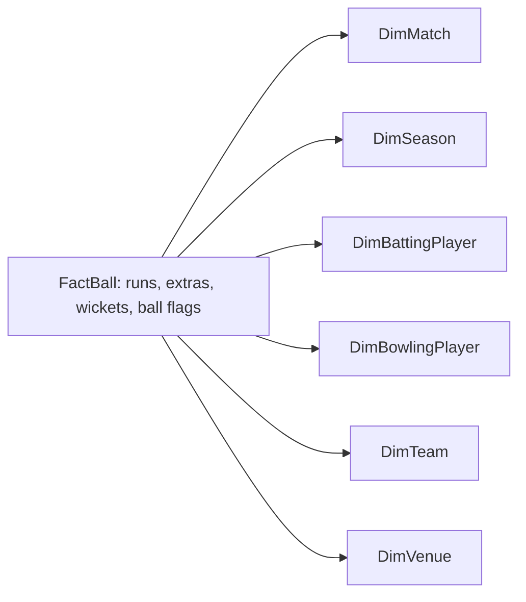

# Suggested Star Schema

Use a ball-level fact table for the most flexible model. Keep the match table as a dimension/lookup after confirming match_id uniqueness.

**FactBall grain:** one recorded delivery/ball event per source row (confirm uniqueness in QA). `match_id` + innings + over + ball position may be used as a candidate key but validate extras/duplicate-ball conventions before relying on it.

**Dimensions:** Match (match date, match type, winner, player of match), Season, Player (player name; role may be added only if sourced), Team, Venue/City. For player comparison, use role-playing player dimensions (batter and bowler) or a unified player dimension with separate relationships.
